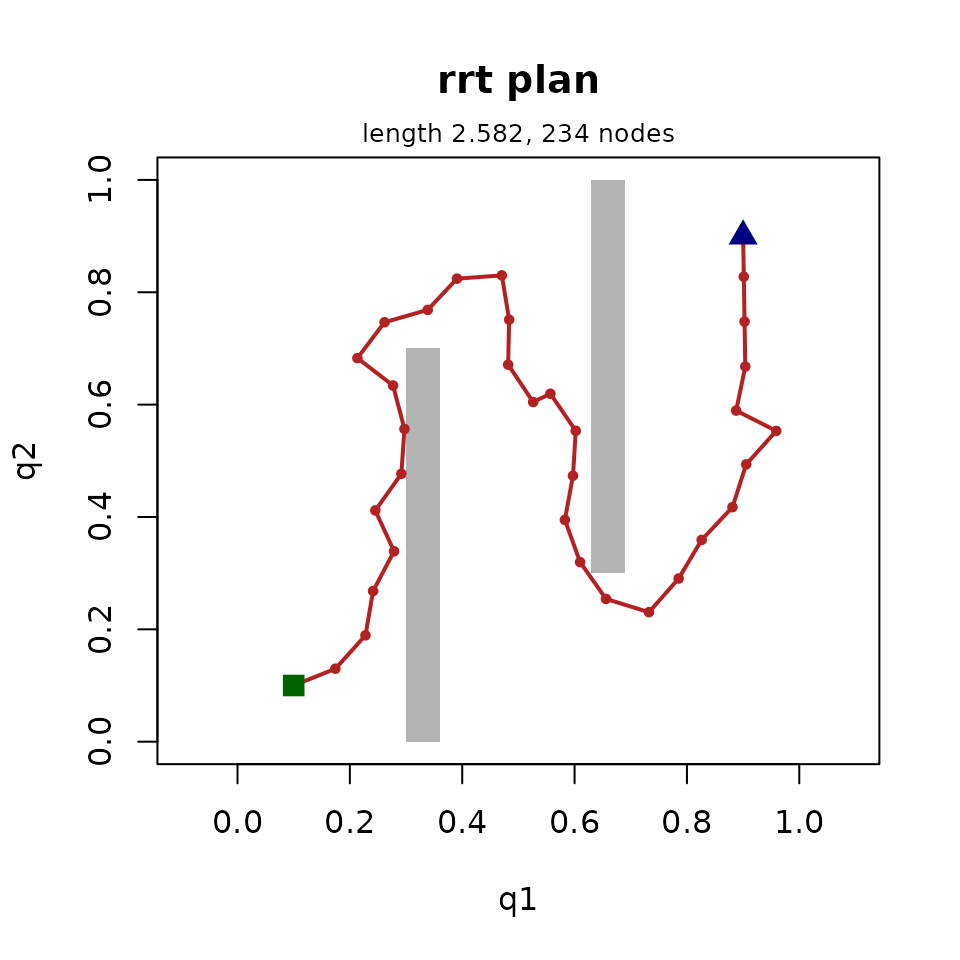
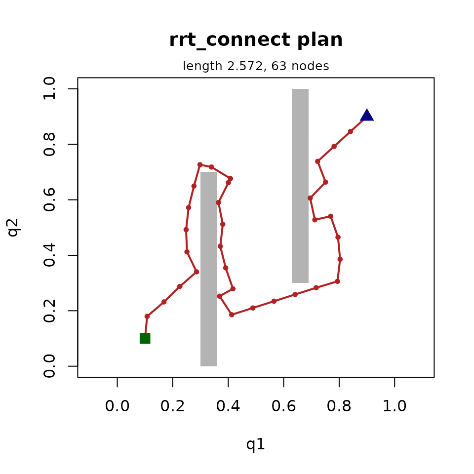
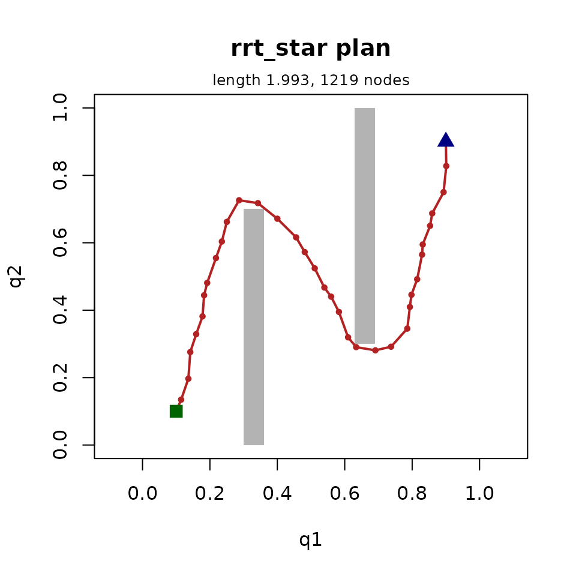
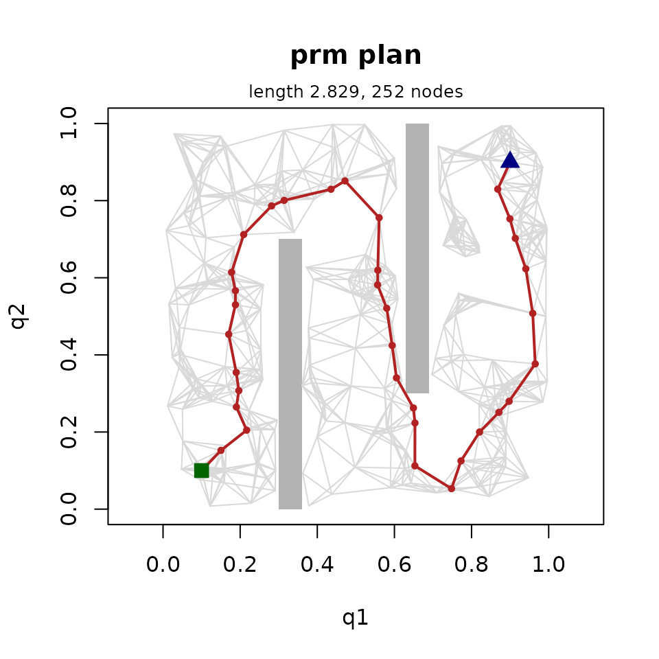

# Collision checking and motion planning

``` r

library(robotcompR)
```

## Geometry and distances

Collision primitives are convex: spheres, boxes, cylinders, capsules and
convex hulls of points. Each is represented internally as a core shape
plus a radius, so a capsule is a segment swept by a sphere.

[`geom_distance()`](https://adamrsophie.github.io/robotcompR/reference/geom_distance.md)
returns the separation distance and witness points. Sphere and capsule
pairs use closed-form segment distances (exact depth when they overlap).
Other pairs use the Gilbert, Johnson and Keerthi (GJK) algorithm on
support functions. When the cores of a GJK pair overlap, the expanding
polytope algorithm (EPA) grows a polytope inside the Minkowski
difference A - B until its face nearest the origin is part of the
boundary; the distance to that face is the penetration depth, the length
of the shortest translation that separates the shapes.

EPA keeps two bounds on the depth: the nearest face of the polytope (a
lower bound) and the smallest support value seen along a face normal (an
upper bound). It stops when they agree to about 10^{-9} of the object
size, and `depth_known` is then `TRUE`. Curved cores in symmetric
positions can exhaust the iteration budget first. Two identical coaxial
cylinders are the classic case, because every radial direction is
equally deep. `depth_known` is then `FALSE`, `distance` is the shallower
estimate and `distance_bounds` brackets the true value. The yes/no
collision answer is exact in both cases.

``` r

geom_distance(geom_sphere(0.5), geom_sphere(0.3), robot_pose(), transl(2, 0, 0))$distance
#> [1] 1.2
d <- geom_distance(geom_box(c(1, 1, 1)), geom_sphere(0.2), robot_pose(), transl(1.5, 1.5, 0))
c(d$distance, sqrt(2) - 0.2)
#> [1] 1.214214 1.214214
d$point_a
#> [1] 0.5 0.5 0.0
geom_distance(geom_box(c(1, 1, 1)), geom_box(c(1, 1, 1)), robot_pose(), transl(0.5, 0, 0))$distance
#> [1] -0.5
# Two unit cubes, one turned 45 degrees: depth 0.5 + sqrt(2) / 2 - 0.9.
geom_distance(geom_box(c(1, 1, 1)), geom_box(c(1, 1, 1)), robot_pose(),
              robot_pose(rotz(pi / 4), c(0.9, 0, 0)))$distance
#> [1] -0.3071068
0.9 - 0.5 - sqrt(2) / 2
#> [1] -0.3071068
cyl <- geom_distance(geom_cylinder(0.5, 10), geom_cylinder(0.5, 10))
cyl[c("depth_known", "distance", "distance_bounds")]
#> $depth_known
#> [1] FALSE
#> 
#> $distance
#> [1] -0.9995293
#> 
#> $distance_bounds
#> [1] -1.0000000 -0.9995293
```

Mesh geometry from URDF files is kept for reference but is not
collidable.

## Robots in an environment

Attach geometry to links with
[`robot_attach_geometry()`](https://adamrsophie.github.io/robotcompR/reference/robot_attach_geometry.md),
or wrap every DH link in a capsule with
[`robot_capsule_links()`](https://adamrsophie.github.io/robotcompR/reference/robot_capsule_links.md).
Obstacles are geometries with world poses.

``` r

arm <- robot_capsule_links(robot_example("planar2"), radius = 0.05)
env <- robot_environment(
  block = geom_box(c(0.4, 0.4, 0.4), origin = transl(1.5, 0, 0)),
  post = geom_cylinder(0.1, 1, origin = transl(-1, 1, 0))
)
robot_check_collision(arm, c(0, 0), env)
#> <robot_collision_result> IN COLLISION; 1 pair evaluated, min distance -0.25
#>  object_a object_b        type distance collision
#>     link2    block environment    -0.25      TRUE
robot_check_collision(arm, c(pi / 2, 0), env, distances = TRUE)
#> <robot_collision_result> collision free; 4 pairs evaluated, min distance 0.85
```

Self-collision checks skip links that share a joint (they always touch
at the joint) and any pairs listed in `ignore_pairs`.

``` r

arm3 <- robot_capsule_links(robot_example("planar3"), 0.05)
robot_check_collision(arm3, c(0, 3, 3))$in_collision
#> [1] TRUE
```

### Paths and the resolution caveat

[`robot_check_path()`](https://adamrsophie.github.io/robotcompR/reference/robot_check_path.md)
interpolates each segment in joint space with steps no larger than
`resolution` and checks every sample. Both endpoints below are free, yet
the straight joint space path sweeps through the block:

``` r

res <- robot_check_path(arm, rbind(c(pi / 2, 0), c(-pi / 2, 0)), env)
res$valid
#> [1] FALSE
res$q
#> [1] 0.1789515 0.0000000
```

This is a discrete check. A thin obstacle can slip between samples if
the resolution is coarse relative to the obstacle size and the link
lengths.

### Continuous checking

`method = "continuous"` removes that caveat with conservative
advancement. At the current configuration it computes the clearance d of
every geometry pair and a bound M on how far any point of the pair can
move per unit of the segment parameter. For a revolute joint, a point at
distance r from the joint axis moves at most r per radian, and r is
bounded by the fixed frame offsets of the chain plus the size of the
geometry. Moving by d / M cannot cause contact, so the check steps
forward by that amount until it either reaches the end of the segment or
a clearance reaches zero. The end configuration of every segment is then
checked with the same contact rule as
[`robot_check_collision()`](https://adamrsophie.github.io/robotcompR/reference/robot_check_collision.md),
so a path that ends touching an obstacle is invalid. Prismatic joints
enter the lever arms through the extension they actually reach on the
segment, so the bound holds with `check_limits = FALSE` and for joints
without finite limits.

Here a thin post sits between two samples of a coarse discrete check:

``` r

post <- robot_environment(post = geom_box(c(0.02, 0.02, 1), origin = transl(cos(0.6), sin(0.6), 0)))
P <- rbind(c(0, 0), c(1.2, 0))
robot_check_path(arm, P, post, resolution = 0.5)$valid
#> [1] TRUE
cc <- robot_check_path(arm, P, post, method = "continuous")
cc$valid
#> [1] FALSE
cc$q
#> [1] 0.5362514 0.0000000
robot_check_collision(arm, cc$q, post)$min_distance
#> [1] 8.367652e-10
```

The configuration returned is the first contact along the motion, up to
the tolerance `tol`.

## Sampling-based planners

[`robot_planner()`](https://adamrsophie.github.io/robotcompR/reference/robot_planner.md)
sets up a planner;
[`robot_plan()`](https://adamrsophie.github.io/robotcompR/reference/robot_plan.md)
runs it.

| Algorithm | Idea | Notes |
|----|----|----|
| `"rrt"` | Grow a tree toward random samples, with goal bias | Fast, paths are jagged |
| `"rrt_connect"` | Two trees that greedily try to meet | Usually fastest for single queries |
| `"rrt_star"` | RRT with rewiring in a shrinking radius | Improves cost as samples increase |
| `"prm"` | Roadmap of random free samples, queried with Dijkstra | Reusable for many queries |

``` r

planner <- robot_planner(arm, "rrt_connect", env, step_size = 0.3)
plan <- robot_plan(planner, start = c(-0.8, 0), goal = c(0.8, 0), seed = 1)
plan
#> <robot_plan> rrt_connect: success
#> path found 
#> 24 waypoints, length 6.671, 67 nodes, 97 iterations, 1.1 s
#> seed: 1
robot_check_path(arm, plan$path, env, resolution = 0.01)$valid
#> [1] TRUE
short <- robot_shortcut(plan, seed = 1)
c(original = plan$length, shortcut = short$length)
#> original shortcut 
#> 6.671026 4.919281
```

A failure only means that no path was found within the budget:

``` r

blocked <- robot_planner(validity = function(q) abs(q[1] - 0.5) > 0.05,
                         bounds = rbind(c(0, 1), c(0, 1)), max_iterations = 200)
robot_plan(blocked, c(0.1, 0.1), c(0.9, 0.1), seed = 1)$message
#> [1] "no path found within the iteration budget (this does not prove that none exists)"
```

### Planning without a robot model

A `validity` function and `bounds` define any configuration space. This
makes the planners easy to study on 2D examples:

``` r

walls <- function(q) {
  !(abs(q[1] - 0.33) < 0.03 && q[2] < 0.7) && !(abs(q[1] - 0.66) < 0.03 && q[2] > 0.3)
}
draw <- function() {
  rect(0.30, 0, 0.36, 0.7, col = "grey70", border = NA)
  rect(0.63, 0.3, 0.69, 1, col = "grey70", border = NA)
}
box <- rbind(c(0, 1), c(0, 1))
for (alg in c("rrt", "rrt_connect", "rrt_star", "prm")) {
  pl <- robot_planner(validity = walls, bounds = box, algorithm = alg,
                      step_size = 0.08, resolution = 0.005,
                      max_iterations = 1500, prm_nodes = 250)
  p <- robot_plan(pl, c(0.1, 0.1), c(0.9, 0.9), seed = 3)
  plot(p, obstacles = draw)
  mtext(sprintf("length %.3f, %d nodes", p$length, p$nodes), side = 3, line = 0.2, cex = 0.8)
}
```



### Practical advice

- Keep `resolution` below the smallest obstacle feature, in joint units.
- Use `seed` for reproducible results; the global random state is
  restored.
- RRT\* converges to optimal paths only as samples grow without bound.
  Use
  [`robot_shortcut()`](https://adamrsophie.github.io/robotcompR/reference/robot_shortcut.md)
  for a quick improvement of any planner’s output.
- Planning runs in R and calls the collision checker many times. Expect
  seconds for 2 to 6 DOF problems with simple geometry.
