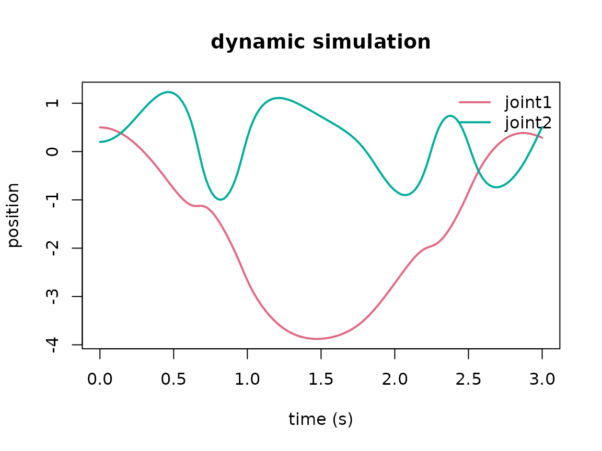
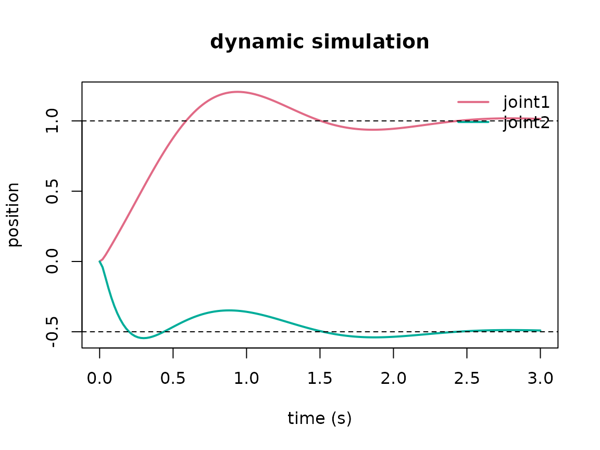

# Rigid body dynamics and simulation

``` r

library(robotcompR)
```

The equations of motion of a rigid multibody system are

M(q)\\\ddot q + C(q, \dot q)\\\dot q + g(q) = \tau + J^\top
f\_{\text{ext}}.

robotcompR computes every term with the spatial vector algorithms of
Featherstone (2008), in the linear-first ordering used throughout the
package:

| Function | Algorithm | Cost |
|----|----|----|
| [`robot_inverse_dynamics()`](https://adamrsophie.github.io/robotcompR/reference/robot_inverse_dynamics.md) | Recursive Newton-Euler (RNEA) | O(n) |
| [`robot_mass_matrix()`](https://adamrsophie.github.io/robotcompR/reference/robot_mass_matrix.md) | Composite rigid body (CRBA) | O(n^2) |
| [`robot_forward_dynamics()`](https://adamrsophie.github.io/robotcompR/reference/robot_forward_dynamics.md) | Articulated body (ABA) | O(n) |
| [`robot_gravity_torque()`](https://adamrsophie.github.io/robotcompR/reference/robot_bias.md), [`robot_coriolis()`](https://adamrsophie.github.io/robotcompR/reference/robot_bias.md), [`robot_bias_forces()`](https://adamrsophie.github.io/robotcompR/reference/robot_bias.md) | RNEA with selected inputs | O(n) |

Gravity is a world-frame vector. It defaults to `c(0, 0, -9.81)`; the
planar examples below move in the xy plane, so they use
`c(0, -9.81, 0)`.

## A reference: the two-link arm

For two uniform rods of mass m = 1 and length l = 1 (center of mass at
l_c = 0.5, inertia I = m l^2 / 12), the mass matrix is

M(q) = \begin{pmatrix} I_1 + I_2 + m_1 l_c^2 + m_2(l_1^2 + l_c^2 + 2 l_1
l_c \cos q_2) & I_2 + m_2(l_c^2 + l_1 l_c \cos q_2) \\ I_2 + m_2(l_c^2 +
l_1 l_c \cos q_2) & I_2 + m_2 l_c^2 \end{pmatrix}.

``` r

arm <- robot_example("planar2")
g <- c(0, -9.81, 0)
q <- c(0.3, 0.7)
M <- robot_mass_matrix(arm, q)
M
#>           joint1    joint2
#> joint1 2.4315089 0.7157544
#> joint2 0.7157544 0.3333333
c2 <- cos(q[2])
M_ref <- matrix(c(1/12 + 1/12 + 0.25 + (1 + 0.25 + c2), 1/12 + 0.25 + 0.5 * c2,
                  1/12 + 0.25 + 0.5 * c2, 1/12 + 0.25), 2)
max(abs(M - M_ref))
#> [1] 4.440892e-16
```

The three algorithms are mutually consistent: RNEA with zero velocity
and gravity and a unit acceleration returns a column of M, and ABA
inverts RNEA.

``` r

qd <- c(0.5, -0.4)
qdd <- c(1, 2)
tau <- robot_inverse_dynamics(arm, q, qd, qdd, gravity = g)
tau
#>    joint1    joint2 
#> 20.648283  4.113131
max(abs(M %*% qdd + robot_bias_forces(arm, q, qd, gravity = g) - tau))
#> [1] 3.552714e-15
max(abs(robot_forward_dynamics(arm, q, qd, tau, gravity = g) - qdd))
#> [1] 6.217249e-15
```

## Gravity compensation and energy

``` r

robot_gravity_torque(arm, c(0, 0), g)
#> joint1 joint2 
#> 19.620  4.905
robot_com(arm, c(0, 0))
#> $mass
#> [1] 2
#> 
#> $position
#> [1] 1 0 0
robot_energy(arm, q, qd, gravity = g)
#>   kinetic potential     total 
#> 0.1874544 8.4759950 8.6634494
```

## External forces

External wrenches are given per link as world-frame `c(force, torque)`
vectors acting at the link frame origin.

``` r

lift <- robot_dh(c(0, 0), c(0, 0), c(0, 0), c(0, 0), c("prismatic", "prismatic"),
                 mass = c(2, 3), com = rbind(c(0, 0, 0), c(0, 0, 0)),
                 inertia = list(diag(0.01, 3), diag(0.01, 3)))
robot_gravity_torque(lift, c(0.1, 0.2))
#> joint1 joint2 
#>  49.05  29.43
robot_inverse_dynamics(lift, c(0.1, 0.2), f_ext = list(link2 = c(0, 0, 3 * 9.81, 0, 0, 0)))
#> joint1 joint2 
#>  19.62   0.00
```

## Simulation

[`robot_simulate()`](https://adamrsophie.github.io/robotcompR/reference/robot_simulate.md)
integrates \ddot q = \text{ABA}(q, \dot q, \tau) with ‘deSolve’. The
torque can be a constant numeric vector or a function
`function(t, q, qd)`, which makes closed-loop control straightforward.

An unforced pendulum swing conserves energy, which is a direct check of
the integrator tolerance and the dynamics:

``` r

sim <- robot_simulate(arm, q0 = c(0.5, 0.2), qd0 = c(0, 0),
                      times = seq(0, 3, by = 0.02), gravity = g)
E <- apply(cbind(sim$q, sim$qd), 1, function(x)
  robot_energy(arm, x[1:2], x[3:4], gravity = g)[["total"]])
diff(range(E))
#> [1] 8.928681e-07
plot(sim, "q")
```



A PD controller with gravity compensation tracks a set point:

``` r

goal <- c(1, -0.5)
Kp <- diag(c(40, 20))
Kd <- diag(c(8, 4))
ctrl <- function(t, q, qd) {
  as.numeric(Kp %*% (goal - q) - Kd %*% qd) + robot_gravity_torque(arm, q, g)
}
pd <- robot_simulate(arm, q0 = c(0, 0), qd0 = c(0, 0),
                     times = seq(0, 3, by = 0.02), torque = ctrl, gravity = g)
tail(pd$q, 1)
#>          joint1     joint2
#> [151,] 1.014188 -0.4907532
plot(pd, "q")
abline(h = goal, lty = 2)
```



Torques follow the joint name rule, both as a constant vector and as the
return value of a callback, so `c(joint2 = 0, joint1 = 1)` applies 1 N m
to `joint1`. The simulation must reach every requested time with finite
values; if the solver stops early (for example because the state blows
up in finite time) the call is an error that carries the solver’s own
message, rather than a silently truncated result:

``` r

slider <- robot_model(list(robot_link("tip", mass = 1)),
                      robot_joint("slide", "prismatic", "base", "tip"))
try(suppressWarnings(robot_simulate(slider, 0, 1, c(0, 0.5, 2, 3),
                                    torque = function(t, q, qd) qd^2,
                                    gravity = c(0, 0, 0))))
#> DLSODA-  Warning..Internal T (=R1) and H (=R2) are
#>       such that in the machine, T + H = T on the next step  
#>      (H = step size). Solver will continue anyway.
#> In above message, R1 = 1, R2 = 4.89642e-17
#>  
#> DLSODA-  Warning..Internal T (=R1) and H (=R2) are
#>       such that in the machine, T + H = T on the next step  
#>      (H = step size). Solver will continue anyway.
#> In above message, R1 = 1, R2 = 4.89642e-17
#>  
#> DLSODA-  Warning..Internal T (=R1) and H (=R2) are
#>       such that in the machine, T + H = T on the next step  
#>      (H = step size). Solver will continue anyway.
#> In above message, R1 = 1, R2 = 4.89642e-17
#>  
#> DLSODA-  Warning..Internal T (=R1) and H (=R2) are
#>       such that in the machine, T + H = T on the next step  
#>      (H = step size). Solver will continue anyway.
#> In above message, R1 = 1, R2 = 4.89642e-17
#>  
#> DLSODA-  Warning..Internal T (=R1) and H (=R2) are
#>       such that in the machine, T + H = T on the next step  
#>      (H = step size). Solver will continue anyway.
#> In above message, R1 = 1, R2 = 4.89642e-17
#>  
#> DLSODA-  Warning..Internal T (=R1) and H (=R2) are
#>       such that in the machine, T + H = T on the next step  
#>      (H = step size). Solver will continue anyway.
#> In above message, R1 = 1, R2 = 4.02389e-17
#>  
#> DLSODA-  Warning..Internal T (=R1) and H (=R2) are
#>       such that in the machine, T + H = T on the next step  
#>      (H = step size). Solver will continue anyway.
#> In above message, R1 = 1, R2 = 4.02389e-17
#>  
#> DLSODA-  Warning..Internal T (=R1) and H (=R2) are
#>       such that in the machine, T + H = T on the next step  
#>      (H = step size). Solver will continue anyway.
#> In above message, R1 = 1, R2 = 4.02389e-17
#>  
#> DLSODA-  Warning..Internal T (=R1) and H (=R2) are
#>       such that in the machine, T + H = T on the next step  
#>      (H = step size). Solver will continue anyway.
#> In above message, R1 = 1, R2 = 4.02389e-17
#>  
#> DLSODA-  Warning..Internal T (=R1) and H (=R2) are
#>       such that in the machine, T + H = T on the next step  
#>      (H = step size). Solver will continue anyway.
#> In above message, R1 = 1, R2 = 4.02389e-17
#>  
#> DLSODA-  Above warning has been issued I1 times.  
#>      It will not be issued again for this problem.
#> In above message, I1 = 10
#>  
#> DLSODA-  At current T (=R1), MXSTEP (=I1) steps   
#>       taken on this call before reaching TOUT     
#> In above message, I1 = 5000
#>  
#> In above message, R1 = 1
#>  
#> Error : The ODE solver stopped at t = 1 before reaching t = 3 (divergent or stiff dynamics, or too few steps; see `...`). Solver: an excessive amount of work (> maxsteps ) was done, but integration was not successful - increase maxsteps Returning early. Results are accurate, as far as they go
```

## Larger trees

The algorithms run unchanged on branched trees:

``` r

tree <- robot_example("branched")
qt <- c(0.3, -0.5, 0.4, -0.2)
Mt <- robot_mass_matrix(tree, qt)
round(Mt, 4)
#>                    shoulder  elbow finger_left_joint finger_right_joint
#> shoulder             0.1835 0.0141            0.0017             0.0014
#> elbow                0.0141 0.0032            0.0004             0.0004
#> finger_left_joint    0.0017 0.0004            0.0002             0.0000
#> finger_right_joint   0.0014 0.0004            0.0000             0.0002
isSymmetric(Mt)
#> [1] TRUE
min(eigen(Mt)$values) > 0
#> [1] TRUE
```

## Limitations

- Joint friction, damping, motor inertia and transmissions are not
  modeled. URDF `<dynamics>` values are kept but ignored, with a
  warning.
- No contact or impact dynamics.
- Forward dynamics fails with a clear error when a joint drives no
  inertia (for example a massless distal link), since the articulated
  inertia is then singular.
