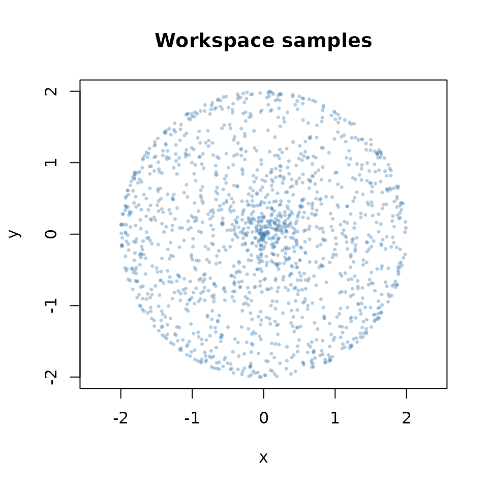
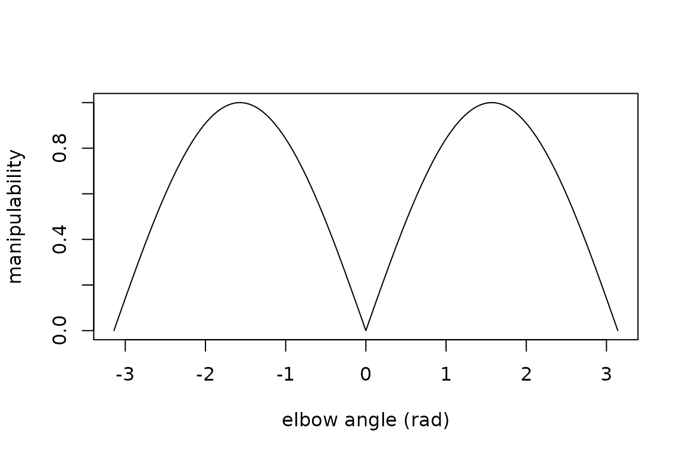

# Forward kinematics, Jacobians and inverse kinematics

``` r

library(robotcompR)
```

## Forward kinematics

For a tree, the pose of every link follows from a single pass from the
base outward.
[`robot_fk()`](https://adamrsophie.github.io/robotcompR/reference/robot_fk.md)
returns the end-effector pose by default, any named frame, or all
frames.

``` r

arm <- robot_example("planar2")
q <- c(0.6, -1.1)
robot_fk(arm, q)
#> <robot_pose> SE(3) world <- link2
#>         [,1]   [,2] [,3]   [,4]
#> [1,]  0.8776 0.4794    0 1.7029
#> [2,] -0.4794 0.8776    0 0.0852
#> [3,]  0.0000 0.0000    1 0.0000
#> [4,]  0.0000 0.0000    0 1.0000
# Closed form for unit links.
c(cos(q[1]) + cos(q[1] + q[2]), sin(q[1]) + sin(q[1] + q[2]))
#> [1] 1.70291818 0.08521693
```

Batches of configurations go one per row:

``` r

Q <- rbind(c(0, 0), c(pi / 2, 0), c(pi / 2, pi / 2))
robot_fk_positions(arm, Q)
#>                  x y z
#> [1,]  2.000000e+00 0 0
#> [2,]  2.220446e-16 2 0
#> [3,] -1.000000e+00 1 0
```

``` r

robot_plot_workspace(arm, n = 1500, seed = 1)
```



## The geometric Jacobian

The geometric Jacobian J(q) maps joint velocities to the spatial
velocity of a point on the end effector, linear part first:

\begin{pmatrix} v \\ \omega \end{pmatrix} = J(q) \\ \dot q.

For a revolute joint i with world axis z_i through point p_i, column i
is (z_i \times (p - p_i), \\ z_i); for a prismatic joint it is (z_i, 0).

`reference = "world"` expresses both parts in world coordinates at the
end-effector origin. `"local"` expresses them in the end-effector frame,
and `"space"` returns the spatial (twist) Jacobian at the world origin.

``` r

J <- robot_jacobian(arm, q)
round(J, 6)
#>       joint1   joint2
#> vx -0.085217 0.479426
#> vy  1.702918 0.877583
#> vz  0.000000 0.000000
#> wx  0.000000 0.000000
#> wy  0.000000 0.000000
#> wz  1.000000 1.000000
Jn <- robot_jacobian_numeric(arm, q)
max(abs(J - Jn))
#> [1] 1.393426e-10
```

The analytic Jacobian differentiates a minimal orientation
parametrization instead. It becomes singular where that parametrization
does, which is why the geometric Jacobian is preferred for control.

``` r

puma <- robot_example("puma560")
qp <- c(0.1, -0.5, 0.3, 0.2, 0.4, -0.3)
round(robot_jacobian_analytic(puma, qp, representation = "rpy"), 4)
#>       joint1  joint2  joint3 joint4  joint5  joint6
#> x     0.1009 -0.2111 -0.4171 0.0000  0.0000  0.0000
#> y     0.4972 -0.0212 -0.0418 0.0000  0.0000  0.0000
#> z     0.0000  0.4846  0.1057 0.0000  0.0000  0.0000
#> roll  0.0000  0.1187  0.1187 0.2006  0.3130 -0.1838
#> pitch 0.0000 -0.9932 -0.9932 0.0232 -0.9506 -0.0991
#> yaw   1.0000 -0.0216 -0.0216 0.9436 -0.0963  1.0119
```

## Manipulability and singularities

Yoshikawa’s measure w = \sqrt{\det(J J^\top)} is zero at singularities.
robotcompR reports the product of the singular values of the selected
rows, which equals w when there are no more rows than joints. A planar
arm has an identically zero z row, so select `rows = 1:2` for the
classical value. The condition number of the translational block
measures isotropy.

``` r

m <- robot_manipulability(arm, q, rows = 1:2)
m$yoshikawa
#> [1] 0.8912074
abs(sin(q[2]))  # closed form for unit links
#> [1] 0.8912074
m$condition
#> [1] 4.142772
robot_manipulability(arm, c(0.3, 0), rows = 1:2)$condition
#> [1] Inf
robot_is_singular(arm, c(0.3, 0))
#> [1] TRUE
#> attr(,"manipulability")
#> <robot_manipulability> translational rows (vx, vy, vz)
#> singular values: 2.2361, 1.0641e-16
#> rank 1, Yoshikawa 2.37933e-16, condition Inf, SINGULAR
```

``` r

elbow <- seq(-pi, pi, length.out = 181)
w <- sapply(elbow, function(t) robot_manipulability(arm, c(0, t), rows = 1:2)$yoshikawa)
plot(elbow, w, type = "l", xlab = "elbow angle (rad)", ylab = "manipulability")
```



## Inverse kinematics

[`robot_ik()`](https://adamrsophie.github.io/robotcompR/reference/robot_ik.md)
solves \min_q e(q)^\top W e(q) = \\W^{1/2} e(q)\\^2, where e stacks the
position error and the rotation-vector orientation error and W =
\operatorname{diag}(\text{weights}). Three methods are available:

- `"levenberg_marquardt"` (default): damping scaled by the largest
  diagonal entry of J^\top W J, adapted after each accepted or rejected
  step.
- `"damped_least_squares"`: fixed damping \lambda, robust near
  singularities.
- `"pseudoinverse"`: Gauss-Newton with backtracking.

Steps are limited to `max_step` radians or meters. Joint limits are
enforced by projection, and joints pushed against a limit are frozen for
that step (an active set) so the others keep moving. When a run does not
converge, up to `restarts` (default 5) further runs start from random
configurations drawn with a fixed `seed`, so results are reproducible
and the global random state is untouched.

``` r

target <- robot_fk(puma, qp)
sol <- robot_ik(puma, target, initial = rep(0, 6))
sol$converged
#> [1] TRUE
c(position = sol$position_error, orientation = sol$orientation_error)
#>     position  orientation 
#> 2.979687e-16 2.186695e-16
sol$iterations
#> [1] 6
max(abs(robot_fk(puma, sol$q)$matrix - target$matrix))
#> [1] 2.775558e-16
```

Inverse kinematics is rarely unique. The returned solution depends on
the initial guess:

``` r

s1 <- robot_ik(arm, robot_pose(translation = c(1, 1, 0)), initial = c(0, 1),
               weights = c(1, 1, 0, 0, 0, 0))
s2 <- robot_ik(arm, robot_pose(translation = c(1, 1, 0)), initial = c(1.5, -1),
               weights = c(1, 1, 0, 0, 0, 0))
rbind(s1$q, s2$q)
#>             joint1    joint2
#> [1,] -3.376762e-14  1.570796
#> [2,]  1.570796e+00 -1.570796
ik_planar2(1, 1, 1, 1)
#>                       q1        q2
#> q2_positive 1.110223e-16  1.570796
#> q2_negative 1.570796e+00 -1.570796
```

Unreachable targets are reported, not hidden. The solver returns the
closest configuration it found, `converged = FALSE`, and a reach bound:

``` r

far <- robot_ik(arm, robot_pose(translation = c(3, 0, 0)),
                weights = c(1, 1, 0, 0, 0, 0))
far$converged
#> [1] FALSE
far$position_error
#> [1] 1
far$reach_bound
#> [1] 2
far$target_distance
#> [1] 3
```

Weights select which components matter. A planar arm cannot control all
six, so here only x and y are weighted. For a 6 DOF arm, a zero weight
on the yaw row would ask only for position and two tilt angles.

## Limits

``` r

lim <- robot_ik(puma, target, initial = rep(0, 6), respect_limits = TRUE)
robot_within_limits(puma, lim$q)
#> [1] TRUE
lim$active_limits
#> character(0)
```
