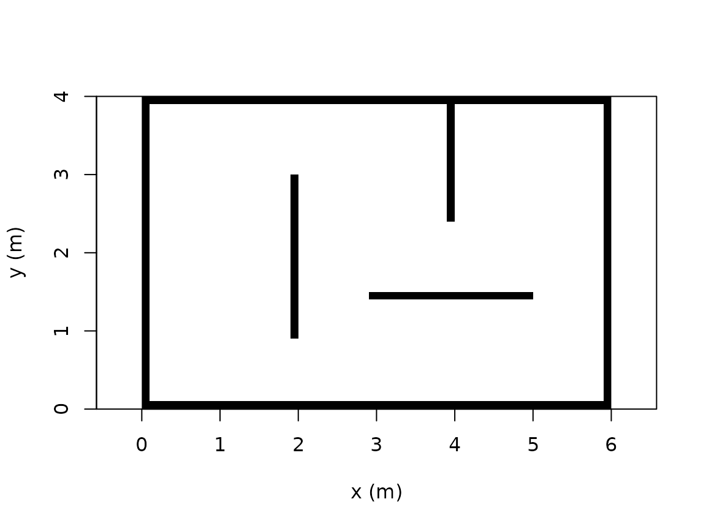
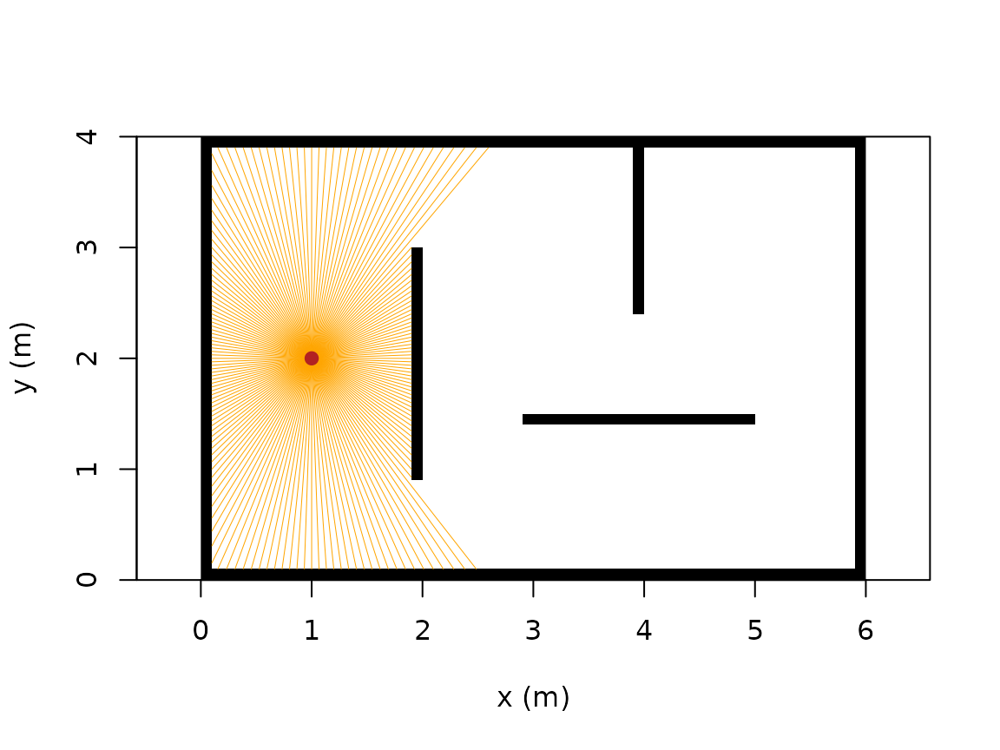
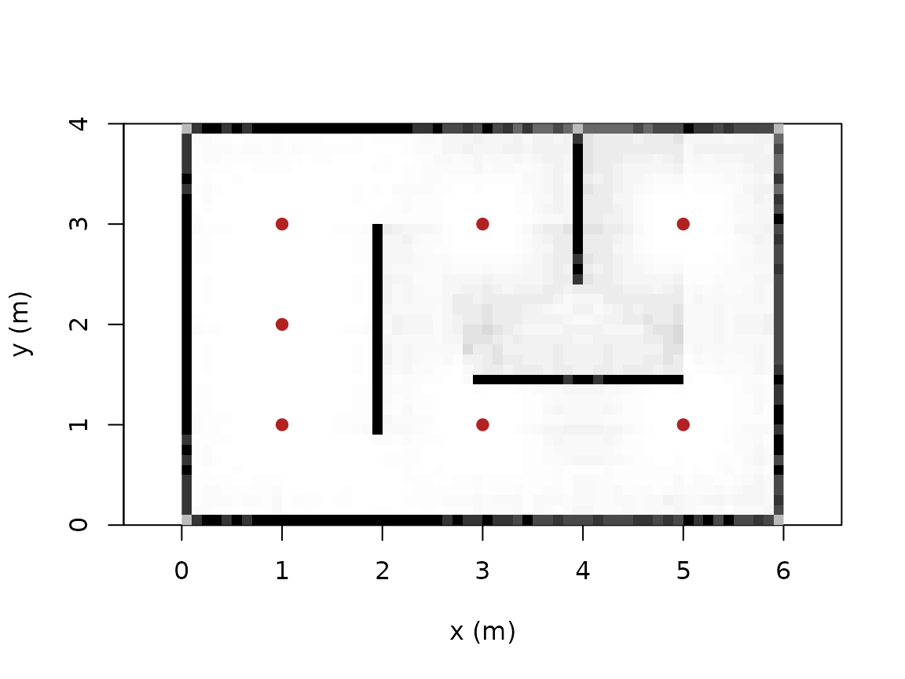
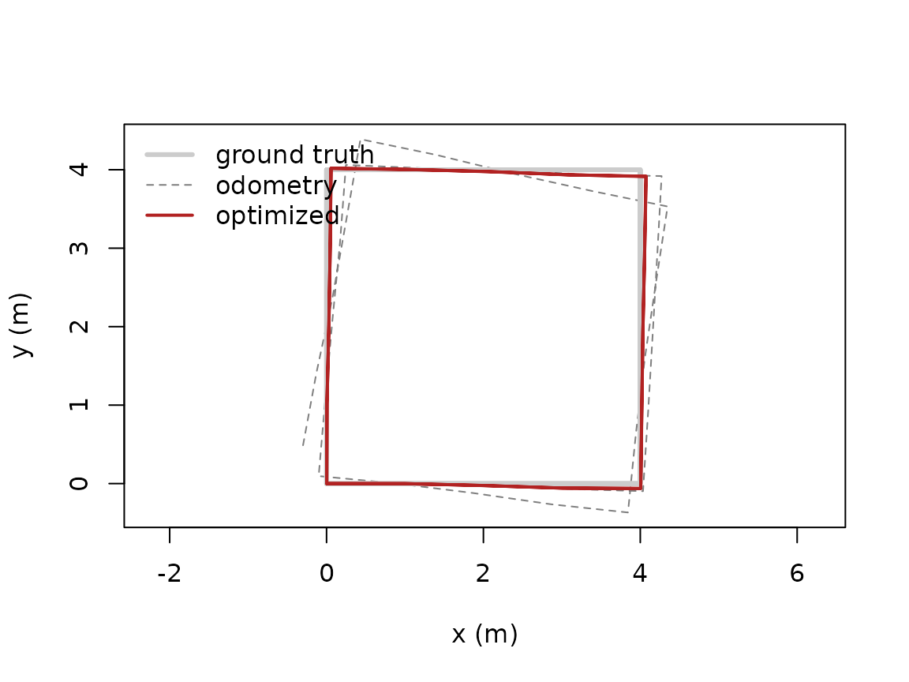
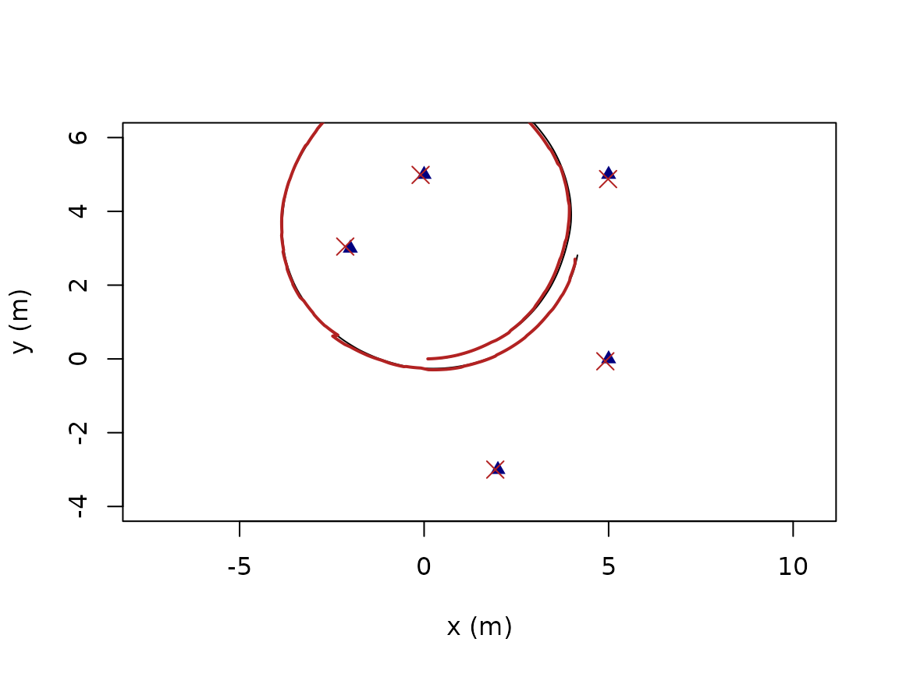

# Occupancy grids, grid planning and pose graph SLAM

``` r

library(robotcompR)
```

## Occupancy grids

An occupancy grid stores, for each cell, the log-odds \ell =
\log\frac{p}{1 - p} that the cell is occupied. Independent observations
add in log-odds, so updates are cheap and order independent. Cell
`[i, j]` covers row `i` in y and column `j` in x.

``` r

occ <- matrix(FALSE, 40, 60)
occ[c(1, 40), ] <- TRUE
occ[, c(1, 60)] <- TRUE
occ[10:30, 20] <- TRUE
occ[15, 30:50] <- TRUE
occ[25:40, 40] <- TRUE
world <- robot_occupancy_grid(c(0, 6), c(0, 4), resolution = 0.1, occupied = occ)
world
#> <robot_occupancy_grid> 40 by 60 cells of 0.1 m covering [0, 6] x [0, 4]
plot(world)
```



Coordinate conversion:

``` r

grid_world_to_cell(world, rbind(c(0.05, 0.05), c(2.55, 1.05), c(9, 9)))
#>      row col
#> [1,]   1   1
#> [2,]  11  26
#> [3,]  NA  NA
grid_cell_to_world(world, cbind(11, 26))
#>         x    y
#> [1,] 2.55 1.05
```

## Simulated range scans

[`grid_raycast()`](https://adamrsophie.github.io/robotcompR/reference/grid_scans.md)
walks each beam through the grid with the exact traversal of Amanatides
and Woo (1987) and returns the distance to the first occupied cell
boundary, or `max_range`.

``` r

pose <- c(1, 2, 0)
angles <- seq(-pi, pi, length.out = 181)[-181]
ranges <- grid_raycast(world, pose, angles, max_range = 4)
plot(world)
hits <- cbind(pose[1] + ranges * cos(angles), pose[2] + ranges * sin(angles))
segments(pose[1], pose[2], hits[, 1], hits[, 2], col = "orange", lwd = 0.5)
points(pose[1], pose[2], pch = 19, col = "firebrick")
```



## Mapping with known poses

[`grid_update_scan()`](https://adamrsophie.github.io/robotcompR/reference/grid_scans.md)
applies the inverse sensor model: cells a beam passes through become
more likely free, the cell where it ends more likely occupied, and beams
at `max_range` only clear space. Log-odds are clamped so the map can
still change later.

``` r

map <- robot_occupancy_grid(c(0, 6), c(0, 4), resolution = 0.1)
route <- rbind(c(1, 2, 0), c(1, 1, 0), c(3, 1, 0), c(5, 1, pi / 2), c(5, 3, pi),
               c(3, 3, pi), c(1, 3, -pi / 2))
for (i in seq_len(nrow(route))) {
  z <- grid_raycast(world, route[i, ], angles, max_range = 4)
  map <- grid_update_scan(map, route[i, ], angles, z, max_range = 4)
}
plot(map)
points(route[, 1:2], pch = 19, col = "firebrick")
```



``` r

mean(grid_occupied(map) == occ)
#> [1] 0.9979167
```

[`grid_probability()`](https://adamrsophie.github.io/robotcompR/reference/grid_coordinates.md)
converts the log-odds back to occupancy probabilities; unobserved cells
stay at 0.5:

``` r

range(grid_probability(map))
#> [1] 0.006692851 0.993307149
mean(grid_probability(map) == 0.5)
#> [1] 0.002083333
```

## Grid planning with A\*

[`grid_astar()`](https://adamrsophie.github.io/robotcompR/reference/grid_astar.md)
searches the 8-connected grid with Euclidean costs and an admissible
Euclidean heuristic, so the result is a shortest grid path. Diagonal
moves may not cut obstacle corners. To plan for a disc-shaped robot,
inflate obstacles by its radius first.

``` r

inflated <- grid_inflate(world, radius = 0.2)
path <- grid_astar(world, c(0.5, 0.5), c(5.5, 3.5), occupied = inflated)
nrow(path)
#> [1] 56
plot(world)
image(seq(0.05, 5.95, 0.1), seq(0.05, 3.95, 0.1), t(inflated & !occ),
      col = c(NA, grDevices::adjustcolor("orange", 0.3)), add = TRUE)
lines(path, col = "firebrick", lwd = 2)
```


When the goal is unreachable,
[`grid_astar()`](https://adamrsophie.github.io/robotcompR/reference/grid_astar.md)
returns `NULL`.

## Pose graph SLAM

A pose graph has one node per robot pose and one edge per relative pose
measurement z\_{ij} (pose of node j in the frame of node i) with
information matrix \Omega\_{ij}. Odometry adds edges between consecutive
nodes; loop closures add edges between distant ones. Optimization solves

\min\_{x_1, \ldots, x_n} \sum\_{(i, j)} e\_{ij}^\top \Omega\_{ij}
e\_{ij}, \qquad e\_{ij} = \begin{pmatrix} R_z^\top\left(R_i^\top (t_j -
t_i) - t_z\right) \\ \operatorname{wrap}(\theta_j - \theta_i - \theta_z)
\end{pmatrix},

with Gauss-Newton steps, Levenberg-Marquardt damping, analytic Jacobians
and a sparse normal-equation solve. The first node is fixed to remove
the gauge freedom.

``` r

# A robot drives around a square twice; odometry drifts in heading.
set.seed(3)
steps <- rep(c(rep(c(1, 0, 0), 3), c(1, 0, pi / 2)), 8)
steps <- matrix(steps, ncol = 3, byrow = TRUE)
truth <- matrix(0, nrow(steps) + 1, 3)
odom <- truth
compose <- function(x, z) {
  c(x[1] + cos(x[3]) * z[1] - sin(x[3]) * z[2],
    x[2] + sin(x[3]) * z[1] + cos(x[3]) * z[2], wrap_angle(x[3] + z[3]))
}
noisy <- steps
noisy[, 3] <- noisy[, 3] + rnorm(nrow(steps), 0, 0.03)
noisy[, 1] <- noisy[, 1] + rnorm(nrow(steps), 0, 0.02)
for (k in seq_len(nrow(steps))) {
  truth[k + 1, ] <- compose(truth[k, ], steps[k, ])
  odom[k + 1, ] <- compose(odom[k, ], noisy[k, ])
}
g <- robot_pose_graph(odom)
for (k in seq_len(nrow(steps))) {
  g <- pose_graph_add_edge(g, k, k + 1, noisy[k, ], diag(c(100, 100, 400)))
}
# Loop closures: the robot recognizes places it visited one lap earlier.
for (k in 1:16) {
  g <- pose_graph_add_edge(g, k, k + 16, c(0, 0, 0), diag(c(400, 400, 1000)))
}
res <- pose_graph_optimize(g)
res$converged
#> [1] TRUE
res$iterations
#> [1] 5
signif(res$cost, 3)
#> [1] 763.00   6.08   4.64   4.64   4.64
plot(odom[, 1:2], type = "l", col = "grey50", lty = 2, asp = 1,
     xlab = "x (m)", ylab = "y (m)")
lines(truth[, 1:2], lwd = 3, col = "grey80")
lines(res$graph$nodes[, 1:2], col = "firebrick", lwd = 2)
legend("topleft", c("ground truth", "odometry", "optimized"),
       col = c("grey80", "grey50", "firebrick"), lty = c(1, 2, 1), lwd = c(3, 1, 2), bty = "n")
```



`converged` means the result is stationary, not just that the cost
stopped moving. The optimizer stops with `status = "converged"` when
every residual coordinate is at roundoff level, or when every gradient
component is negligible relative to the size of the terms it sums
(`gradient_tol`, default 10^{-6}). Both tests are coordinatewise, so a
large irreducible cost in one coordinate cannot hide an error in
another. Other outcomes are `"stalled"`, `"max_iterations"`,
`"linear_solve_failed"` and `"invalid_graph"` (nodes not connected to
the fixed node):

``` r

res$status
#> [1] "converged"
res$gradient
#> [1] 6.239549e-08
loose <- pose_graph_optimize(g, max_iterations = 2)
c(loose$status, loose$converged)
#> [1] "max_iterations" "FALSE"
```

The plot method draws the graph, with loop closures dashed:

``` r

plot(res$graph)
```


### SE(3) pose graphs

Give
[`robot_pose_graph()`](https://adamrsophie.github.io/robotcompR/reference/robot_pose_graph.md)
a list of SE(3) poses instead of a matrix and the same functions
optimize a 3D graph. Edges are relative `robot_pose` measurements with 6
by 6 information matrices (translation first), the residual is e\_{ij} =
\log(Z\_{ij}^{-1} X_i^{-1} X_j), and nodes are updated on the manifold
as X \exp(\delta).

``` r

set.seed(4)
step <- se3_exp(c(1, 0, 0.1, 0, 0.15, 2 * pi / 12))
truth3 <- Reduce(function(X, k) X %*% step, 1:24, accumulate = TRUE, init = diag(4))
noisy3 <- lapply(1:24, function(k) step %*% se3_exp(rnorm(6, sd = 0.02)))
odom3 <- Reduce(function(X, Z) X %*% Z, noisy3, accumulate = TRUE, init = diag(4))
g3 <- robot_pose_graph(odom3)
for (k in 1:24) g3 <- pose_graph_add_edge(g3, k, k + 1, noisy3[[k]], diag(2500, 6))
# The helix revisits each heading after 12 steps, 1.2 m higher.
for (k in 1:13) {
  g3 <- pose_graph_add_edge(g3, k, k + 12, solve(truth3[[k]]) %*% truth3[[k + 12]],
                            diag(1e4, 6))
}
res3 <- pose_graph_optimize(g3)
res3$converged
#> [1] TRUE
err <- function(nodes) max(vapply(seq_along(nodes), function(k)
  sqrt(sum((pose_translation(nodes[[k]]) - truth3[[k]][1:3, 4])^2)), 0))
c(odometry = err(lapply(odom3, function(M) robot_pose(matrix = M))),
  optimized = err(res3$graph$nodes))
#>   odometry  optimized 
#> 0.41548311 0.07660563
```

## EKF-SLAM

When landmarks are not known in advance,
[`robot_ekf_slam()`](https://adamrsophie.github.io/robotcompR/reference/robot_ekf_slam.md)
estimates them together with the pose. The state grows by two entries
each time a new landmark id is seen; the new landmark is initialized
from the inverse measurement model with its covariance and its
correlation with the pose. Later sightings correct both the pose and
every correlated landmark.

``` r

L <- rbind(a = c(5, 0), b = c(0, 5), c = c(5, 5), d = c(-2, 3), e = c(2, -3))
Q <- diag(c(0.02, 0.01))
R <- diag(c(0.05, 0.002))
f <- robot_ekf_slam(c(0, 0, 0), diag(1e-9, 3), Q, R)
truth <- odo <- c(0, 0, 0)
set.seed(7)
tr <- matrix(NA, 300, 3)
est <- tr
for (k in 1:300) {
  u <- c(1, 0.25)
  un <- u + as.numeric(rnorm(2) %*% chol(Q))
  truth <- unicycle_step(truth, un[1], un[2], 0.1)
  f <- ekf_slam_predict(f, u, 0.1)
  if (k %% 5 == 0) {
    f <- ekf_slam_update(f, landmark_measurements(truth, L, R, max_range = 6, seed = k))
  }
  tr[k, ] <- truth
  est[k, ] <- f$mean[1:3]
}
f
#> <robot_ekf_slam> pose: 4.0892, 2.7046, 1.3608 ; 5 landmarks
M <- ekf_slam_landmarks(f)
round(cbind(M, error = sqrt(rowSums((M - L[rownames(M), ])^2))), 3)
#>        x      y error
#> a  4.910 -0.064 0.110
#> b -0.095  4.988 0.096
#> d -2.137  3.046 0.145
#> e  1.928 -3.000 0.072
#> c  4.985  4.875 0.126
plot(tr[, 1:2], type = "l", asp = 1, xlab = "x (m)", ylab = "y (m)",
     xlim = c(-3, 6), ylim = c(-4, 6))
lines(est[, 1:2], col = "firebrick", lwd = 2)
points(L, pch = 17, col = "navy")
points(M, pch = 4, cex = 1.5, col = "firebrick")
```



The map is only defined up to the initial pose, which is why the initial
covariance is nearly zero: it anchors the map frame.

The update uses a sparse Joseph form that touches only the pose and the
observed landmarks, so its cost grows with the square of the state size.
When a measurement removes almost all of some variance (a posterior
diagonal below 10^{-6} of its prior), subtracting two nearly equal
numbers would lose the small posterior to cancellation; the update is
then redone in factored form from a pivoted Cholesky factor of the
prior, which keeps the covariance positive semidefinite. A first
sighting with a nonpositive range cannot place a landmark; it is skipped
with a warning instead of initializing the landmark on top of the robot:

``` r

f2 <- robot_ekf_slam(c(0, 0, 0), diag(1e-9, 3), Q, R)
f2 <- ekf_slam_update(f2, data.frame(id = "z", range = 0, bearing = 0))
#> Warning: Landmark 'z' not initialized: its first range (0) is not positive.
nrow(ekf_slam_landmarks(f2))
#> [1] 0
```

## Limitations

- Grids are 2D and use a simple inverse sensor model with no beam width.
- A\* runs in R; grids of a few hundred cells on a side are comfortable.
- The pose graph solver uses Gaussian edges. It has no robust kernels,
  so a single wrong loop closure can distort the map. SE(3) Jacobians
  are computed by finite differences.
- EKF-SLAM uses known data association and dense covariances, so it
  scales quadratically with the number of landmarks.
- Data association (deciding which loop closures are real) is left to
  the user.
