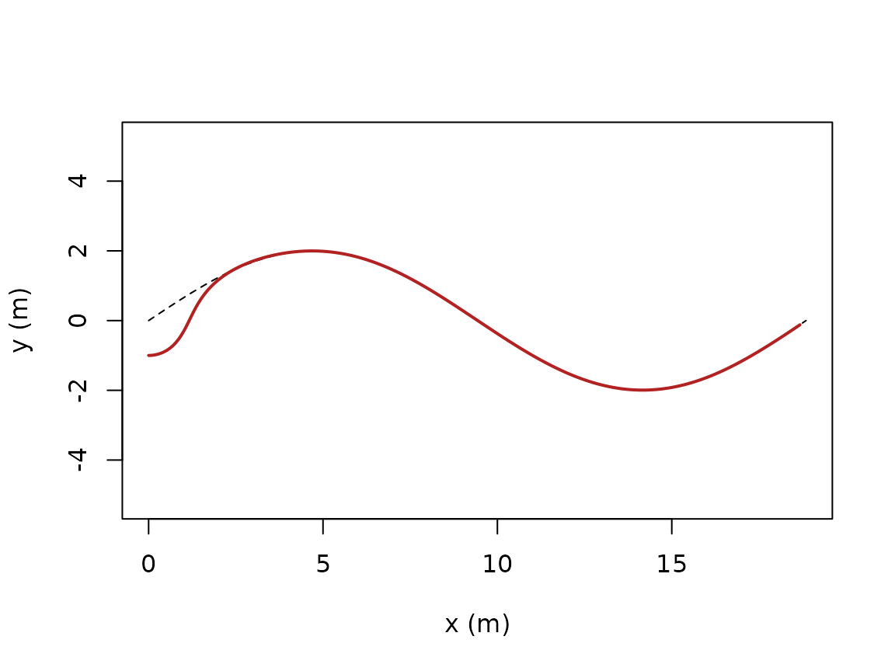
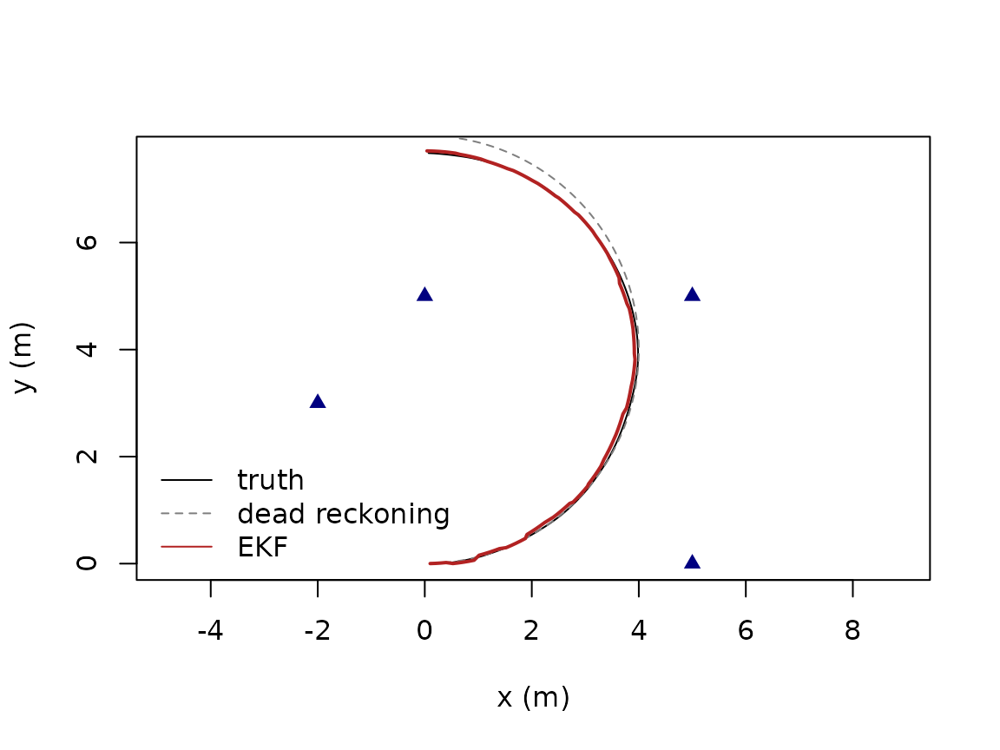
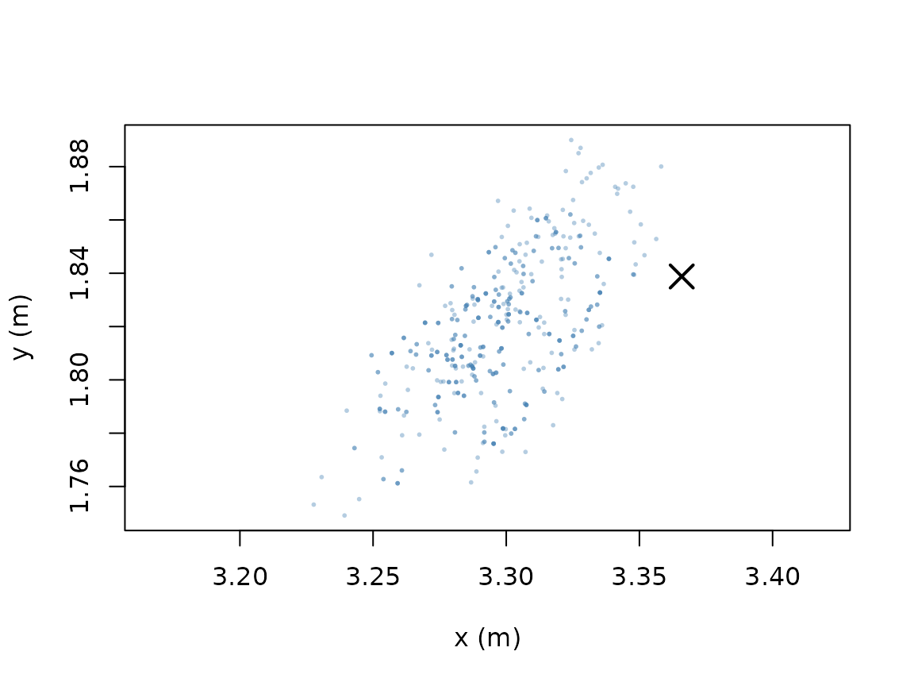

# Mobile robots: motion models, path following and localization

``` r

library(robotcompR)
```

Planar robots have pose x = (x, y, \theta) with the heading wrapped to
\[-\pi, \pi). Body velocities are (v, \omega): forward speed along the
body x axis and turn rate.

## The unicycle and exact integration

\dot x = v\cos\theta, \qquad \dot y = v\sin\theta, \qquad \dot\theta =
\omega.

For constant controls the solution is an arc of radius v/\omega:

x' = x + \frac{v}{\omega}\left(\sin(\theta + \omega\Delta t) -
\sin\theta\right), \quad y' = y - \frac{v}{\omega}\left(\cos(\theta +
\omega\Delta t) - \cos\theta\right).

[`unicycle_step()`](https://adamrsophie.github.io/robotcompR/reference/unicycle_step.md)
uses this closed form (a straight line when \omega \approx 0), which
equals X \exp(\widehat{(v, 0, \omega)}\Delta t) on SE(2). There is no
Euler integration error.

``` r

unicycle_step(c(0, 0, 0), v = pi / 2, omega = pi / 2, dt = 1)
#>        x        y    theta 
#> 1.000000 1.000000 1.570796
sim <- mobile_simulate(robot_unicycle(), c(0, 0, 0), cbind(1, rep(2 * pi / 10, 10)), dt = 1)
round(sim[11, ], 12)
#>  time     x     y theta 
#>    10     0     0     0
```

## Differential drive

With wheel radius r and track width b: v = r(\omega_R + \omega_L)/2 and
\omega = r(\omega_R - \omega_L)/b.

``` r

dd <- robot_diffdrive(wheel_radius = 0.05, track_width = 0.3)
dd
#> <robot_mobile> differential drive, wheel radius 0.05 m, track 0.3 m
diffdrive_forward(dd, omega_left = 10, omega_right = 12)
#>         v     omega 
#> 0.5500000 0.3333333
diffdrive_inverse(dd, v = 0.5, omega = 1)
#>  left right 
#>     7    13
```

Wheel odometry integrates encoder increments as arcs:

``` r

ticks_left <- rep(c(1, 1.2, 0.8), each = 10)
ticks_right <- rep(c(1, 0.8, 1.2), each = 10)
od <- diffdrive_odometry(dd, c(0, 0, 0), ticks_left, ticks_right)
plot(od[, "x"], od[, "y"], type = "l", asp = 1, xlab = "x (m)", ylab = "y (m)")
```


## Kinematic bicycle

Steering angle \delta and wheelbase L give \omega = v\tan\delta / L.
Steering beyond `max_steer` is an error unless `saturate = TRUE`.

``` r

car <- robot_bicycle(wheelbase = 2.5, max_steer = 0.5)
U <- cbind(2, c(rep(0, 5), rep(0.3, 10), rep(-0.3, 10)))
traj <- mobile_simulate(car, c(0, 0, 0), U, dt = 0.5)
plot(traj[, "x"], traj[, "y"], type = "b", asp = 1, xlab = "x (m)", ylab = "y (m)")
```


``` r

try(mobile_simulate(car, c(0, 0, 0), cbind(1, 0.8), 1))
#> Error : Steering 0.8 exceeds max_steer at step 1.
```

## Pure pursuit

Pure pursuit steers toward a lookahead point a distance L_d ahead along
the path. With the lookahead point at lateral offset y_L in the body
frame, the commanded curvature is \kappa = 2 y_L / L_d^2.

``` r

s <- seq(0, 2 * pi, length.out = 80)
path <- cbind(3 * s, 2 * sin(s))
x <- c(0, -1, 0)
track <- x
for (i in 1:2000) {
  u <- pure_pursuit(x, path, lookahead = 1, speed = 1)
  if (u$done) break
  x <- unicycle_step(x, u$v, u$omega, 0.05)
  track <- rbind(track, x)
}
plot(path, type = "l", lty = 2, asp = 1, xlab = "x (m)", ylab = "y (m)")
lines(track[, 1], track[, 2], col = "firebrick", lwd = 2)
```



## Landmark measurements

[`landmark_measurements()`](https://adamrsophie.github.io/robotcompR/reference/landmark_measurements.md)
returns range and bearing (relative to the heading) to each landmark
within range, optionally with Gaussian noise.

``` r

L <- rbind(a = c(5, 0), b = c(0, 5), c = c(5, 5), d = c(-2, 3))
landmark_measurements(c(1, 1, pi / 4), L)
#>   id    range   bearing
#> a  a 4.123106 -1.030377
#> b  b 4.123106  1.030377
#> c  c 5.656854  0.000000
#> d  d 3.605551  1.768192
```

## Extended Kalman filter

[`ekf_predict()`](https://adamrsophie.github.io/robotcompR/reference/robot_ekf.md)
propagates the mean through the exact unicycle model and the covariance
with its analytic Jacobians:

P^- = F P F^\top + G Q G^\top.

[`ekf_update()`](https://adamrsophie.github.io/robotcompR/reference/robot_ekf.md)
linearizes range and bearing, wraps the bearing innovation (so a
measurement of -\pi + \epsilon near a prediction of \pi - \epsilon gives
a small innovation, not one near 2\pi), and updates the covariance in
Joseph form, P = (I - KH)P^-(I - KH)^\top + KRK^\top, which stays
symmetric positive semidefinite.

``` r

Q <- diag(c(0.02, 0.01))
R <- diag(c(0.05, 0.002))
f <- robot_ekf(c(0, 0, 0), diag(0.01, 3), L, Q, R)
truth <- c(0, 0, 0)
odo <- c(0, 0, 0)
set.seed(7)
est <- tru <- dr <- matrix(NA, 120, 3)
for (k in 1:120) {
  u <- c(1, 0.25)
  un <- u + as.numeric(rnorm(2) %*% chol(Q))
  truth <- unicycle_step(truth, un[1], un[2], 0.1)
  odo <- unicycle_step(odo, u[1], u[2], 0.1)
  f <- ekf_predict(f, u, 0.1)
  if (k %% 5 == 0) f <- ekf_update(f, landmark_measurements(truth, L, R, max_range = 6, seed = k))
  est[k, ] <- f$mean
  tru[k, ] <- truth
  dr[k, ] <- odo
}
plot(tru[, 1:2], type = "l", asp = 1, xlab = "x (m)", ylab = "y (m)")
lines(dr[, 1:2], col = "grey50", lty = 2)
lines(est[, 1:2], col = "firebrick", lwd = 2)
points(L, pch = 17, col = "navy")
legend("bottomleft", c("truth", "dead reckoning", "EKF"),
       col = c("black", "grey50", "firebrick"), lty = c(1, 2, 1), bty = "n")
```



``` r

f
#> <robot_ekf> mean: 0.041139, 7.7132, 3.0884 
#> std devs: 0.06808, 0.04205, 0.02355
```

## Particle filter

The particle filter represents the belief with weighted samples. It
handles multimodal beliefs that the EKF cannot. Weights use the Gaussian
likelihood of the wrapped residuals in log space; resampling is low
variance (systematic) and happens when the effective sample size drops
below half the particles. The heading estimate is the weighted circular
mean.

``` r

pf <- robot_particle_filter(500, c(0, 0, 0), diag(c(0.2, 0.2, 0.1)), L, Q, R, seed = 1)
truth <- c(0, 0, 0)
for (k in 1:40) {
  truth <- unicycle_step(truth, 1, 0.25, 0.1)
  pf <- pf_predict(pf, c(1, 0.25), 0.1, seed = k)
  pf <- pf_update(pf, landmark_measurements(truth, L, R, seed = 1000 + k), seed = k)
}
est <- pf_estimate(pf)
rbind(truth = truth, estimate = est$mean)
#>                 x        y     theta
#> truth    3.365884 1.838791 1.0000000
#> estimate 3.297681 1.818802 0.9931689
est$ess
#> [1] 500
plot(pf$particles[, 1:2], pch = 16, cex = 0.4, col = grDevices::adjustcolor("steelblue", 0.4),
     asp = 1, xlab = "x (m)", ylab = "y (m)")
points(truth[1], truth[2], pch = 4, cex = 2, lwd = 2)
```



Filters are values: each step returns a new object and leaves the old
one unchanged, which makes it easy to compare runs.
