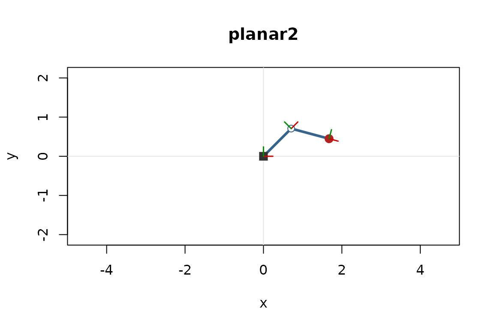

# Getting started with robotcompR

``` r

library(robotcompR)
```

robotcompR is a native R toolkit for robot modeling, kinematics,
dynamics, collision checking, motion planning, trajectory generation and
planar mobile robotics. Everything is written in R on top of base linear
algebra, ‘Matrix’ for sparse least squares, ‘deSolve’ for simulation and
‘xml2’ for URDF files. Nothing requires a robotics middleware
installation.

This article is a tour. Each topic has its own article with derivations,
reference checks and limitations.

## Conventions in one place

| Topic | Convention |
|----|----|
| Units | SI: meters, radians, seconds, kilograms, newtons |
| Rotations | Active, right-handed; matrices act on column vectors |
| Quaternions | Scalar first `c(w, x, y, z)`, Hamilton product, `w >= 0` canonical |
| Euler angles | Intrinsic sequences; `"ZYX"` returns `c(yaw, pitch, roll)` |
| URDF `rpy` | Fixed-axis roll, pitch, yaw: `R = Rz(yaw) Ry(pitch) Rx(roll)` |
| Poses | `T_a_b` maps coordinates in frame b into frame a |
| Composition | `T_a_c = T_a_b * T_b_c`, with frame names checked when present |
| Twists and wrenches | Linear part first: `c(v, w)` and `c(f, tau)` |
| Jacobian rows | Linear velocity rows 1 to 3, angular rows 4 to 6 |
| Joint arrays | Unnamed: [`robot_joint_names()`](https://adamrsophie.github.io/robotcompR/reference/robot_introspection.md) order. Named: exactly the joint names, any order, matched by name |
| Collision results | Separation only when proved by a positive lower bound; unresolved pairs count as contact |
| Points | One point per row in batch functions |
| Planar poses | `c(x, y, theta)` with `theta` wrapped to `[-pi, pi)` |

## A first robot

[`robot_example()`](https://adamrsophie.github.io/robotcompR/reference/robot_example.md)
ships a few reference models. The two-link planar arm has unit links
with uniform 1 kg rods, so most of its quantities have closed forms.

``` r

arm <- robot_example("planar2")
arm
#> <robot_model> planar2: 3 links, 2 joints, 2 degrees of freedom
#> end effector: link2
#>    name     type parent child q_index     lower    upper
#>  joint1 revolute   base link1       1 -3.141593 3.141593
#>  joint2 revolute  link1 link2       2 -3.141593 3.141593
robot_joints(arm)
#>          name     type parent child q_index     lower    upper
#> joint1 joint1 revolute   base link1       1 -3.141593 3.141593
#> joint2 joint2 revolute  link1 link2       2 -3.141593 3.141593
```

Forward kinematics returns a `robot_pose`:

``` r

q <- c(pi / 4, -pi / 3)
T <- robot_fk(arm, q)
T
#> <robot_pose> SE(3) world <- link2
#>         [,1]   [,2] [,3]   [,4]
#> [1,]  0.9659 0.2588    0 1.6730
#> [2,] -0.2588 0.9659    0 0.4483
#> [3,]  0.0000 0.0000    1 0.0000
#> [4,]  0.0000 0.0000    0 1.0000
pose_translation(T)
#> [1] 1.6730326 0.4482877 0.0000000
```

``` r

robot_plot(arm, q, frames = TRUE)
```



## Jacobians, singularities and inverse kinematics

``` r

J <- robot_jacobian(arm, q)
round(J, 4)
#>     joint1 joint2
#> vx -0.4483 0.2588
#> vy  1.6730 0.9659
#> vz  0.0000 0.0000
#> wx  0.0000 0.0000
#> wy  0.0000 0.0000
#> wz  1.0000 1.0000
robot_manipulability(arm, q, rows = 1:2)$yoshikawa
#> [1] 0.8660254
robot_is_singular(arm, c(0.3, 0))
#> [1] TRUE
#> attr(,"manipulability")
#> <robot_manipulability> translational rows (vx, vy, vz)
#> singular values: 2.2361, 1.0641e-16
#> rank 1, Yoshikawa 2.37933e-16, condition Inf, SINGULAR
```

Inverse kinematics reports convergence and the remaining error instead
of silently returning the closest configuration it found:

``` r

target <- robot_pose(translation = c(1.2, 0.8, 0))
sol <- robot_ik(arm, target, initial = c(0.5, -0.5),
                weights = c(1, 1, 0, 0, 0, 0))
sol$converged
#> [1] TRUE
sol$position_error
#> [1] 3.140185e-16
pose_translation(robot_fk(arm, sol$q))
#> [1] 1.2 0.8 0.0
ik_planar2(1.2, 0.8, 1, 1)
#>                     q1        q2
#> q2_positive -0.1773902  1.530786
#> q2_negative  1.3533954 -1.530786
```

## Dynamics

``` r

g <- c(0, -9.81, 0)
robot_mass_matrix(arm, q)
#>           joint1    joint2
#> joint1 2.1666667 0.5833333
#> joint2 0.5833333 0.3333333
robot_gravity_torque(arm, q, g)
#>    joint1    joint2 
#> 15.142942  4.737866
tau <- robot_inverse_dynamics(arm, q, qd = c(0.5, 0), qdd = c(0, 1), gravity = g)
robot_forward_dynamics(arm, q, qd = c(0.5, 0), tau = tau, gravity = g)
#>        joint1        joint2 
#> -2.325413e-15  1.000000e+00
```

## Planning around an obstacle

``` r

robot <- robot_capsule_links(arm, radius = 0.05)
env <- robot_environment(block = geom_box(c(0.4, 0.4, 0.4), origin = transl(1.5, 0, 0)))
planner <- robot_planner(robot, "rrt_connect", env)
plan <- robot_plan(planner, start = c(-0.8, 0), goal = c(0.8, 0), seed = 1,
                   smooth = TRUE)
plan
#> <robot_plan> rrt_connect: success
#> path found (shortcut smoothed) 
#> 5 waypoints, length 4.919, 70 nodes, 97 iterations, 2.35 s
#> seed: 1
traj <- robot_traj_path(plan, vmax = 1, amax = 2, dt = 0.05)
robot_traj_check(robot, traj)$ok
#> [1] TRUE
```

## Mobile robots

``` r

sim <- mobile_simulate(robot_unicycle(), c(0, 0, 0),
                       cbind(1, rep(pi / 8, 16)), dt = 0.5)
plot(sim[, "x"], sim[, "y"], type = "b", asp = 1, xlab = "x (m)", ylab = "y (m)")
```


## Where to go next

- [`vignette("spatial-math")`](https://adamrsophie.github.io/robotcompR/articles/spatial-math.md):
  rotations, quaternions, poses and Lie groups.
- [`vignette("robot-models")`](https://adamrsophie.github.io/robotcompR/articles/robot-models.md):
  joints, links, DH parameters and URDF.
- [`vignette("kinematics")`](https://adamrsophie.github.io/robotcompR/articles/kinematics.md):
  forward kinematics, Jacobians and inverse kinematics.
- [`vignette("dynamics")`](https://adamrsophie.github.io/robotcompR/articles/dynamics.md):
  RNEA, CRBA, ABA and simulation.
- [`vignette("trajectories")`](https://adamrsophie.github.io/robotcompR/articles/trajectories.md):
  polynomial, trapezoidal and Cartesian paths.
- [`vignette("collision-planning")`](https://adamrsophie.github.io/robotcompR/articles/collision-planning.md):
  geometry, distance queries and sampling-based planners.
- [`vignette("mobile-robots")`](https://adamrsophie.github.io/robotcompR/articles/mobile-robots.md):
  wheeled robot models, path following and localization with EKF, UKF
  and particle filters.
- [`vignette("mapping-slam")`](https://adamrsophie.github.io/robotcompR/articles/mapping-slam.md):
  occupancy grids, grid search, EKF-SLAM and SE(2) and SE(3) pose
  graphs.

## Scope and limitations

robotcompR is a teaching and research toolkit, not a real-time
controller. It is written in R, so planners and filters are meant for
problems with a few degrees of freedom and thousands (not millions) of
samples. Specific limits:

- Joints are revolute, continuous, prismatic or fixed. Floating, planar
  and mimic joints are rejected.
- Collision geometry is convex (spheres, boxes, cylinders, capsules and
  convex hulls). Meshes are kept as metadata but are not used for
  queries. Penetration depths come from closed forms or EPA; when EPA
  runs out of iterations the result says so (`depth_known = FALSE`) and
  gives bounds.
- Path collision checks are discrete at a user-chosen resolution or
  continuous by conservative advancement.
- Sampling-based planners are probabilistically complete at best; a
  failure to find a path never proves that none exists.
- Mobile robot tools are planar (SE(2)); pose graphs also handle SE(3).
- No contact dynamics, friction models or actuator models.
