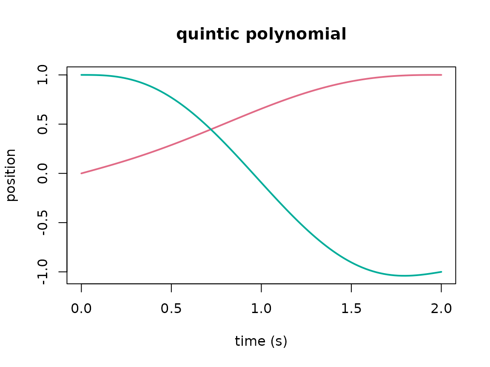
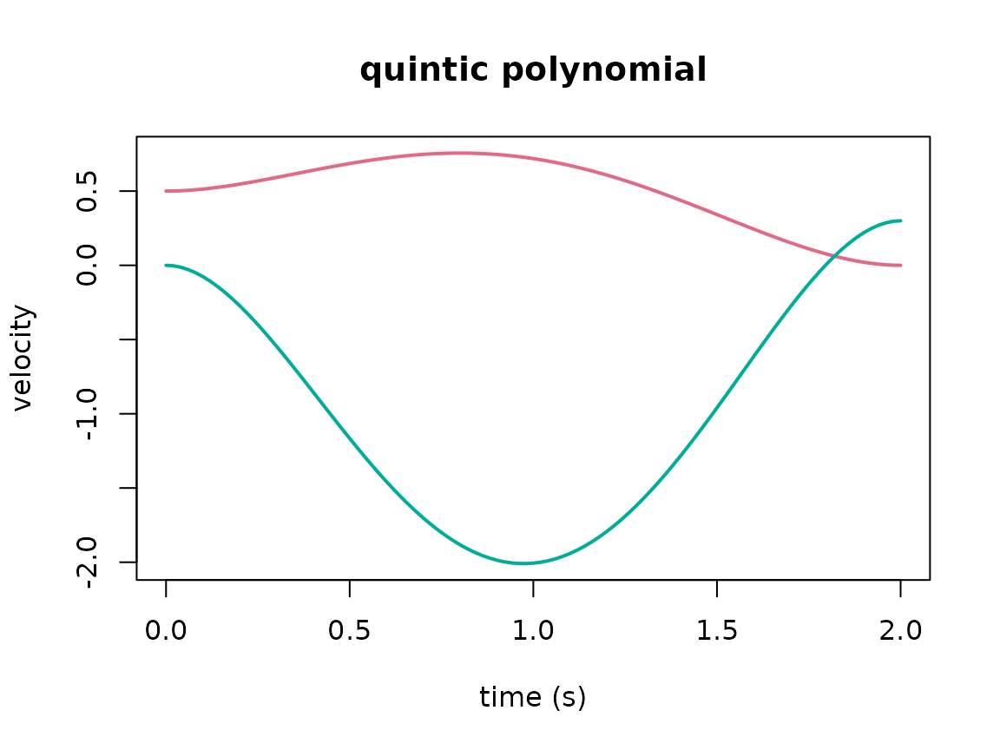
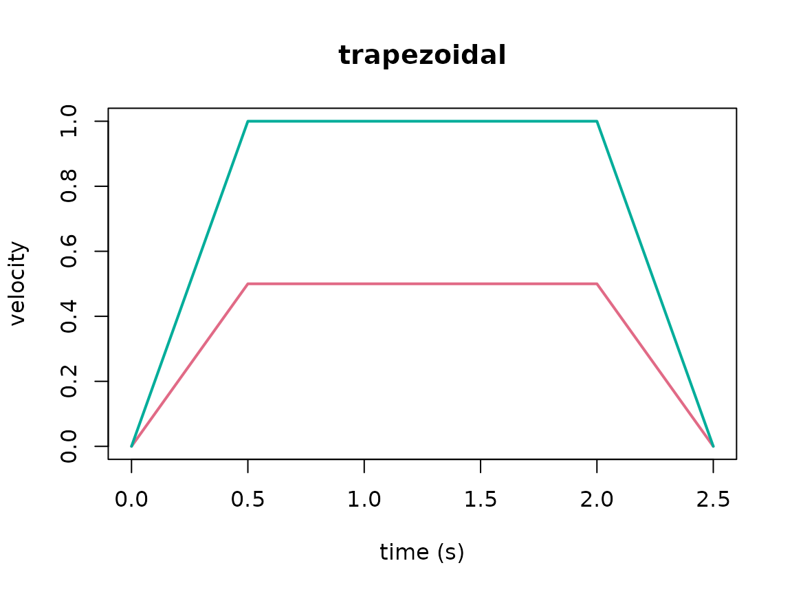
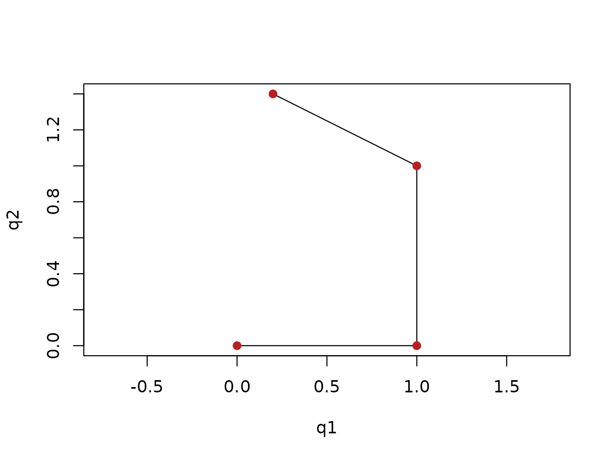
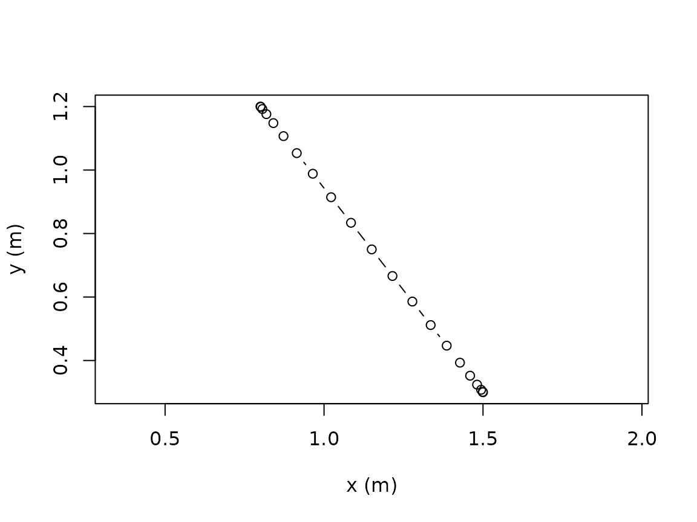

# Trajectory generation

``` r

library(robotcompR)
```

A path is a geometric curve; a trajectory adds timing. robotcompR
returns trajectories as `robot_trajectory` objects with sampled `time`,
`q`, `qd` and `qdd`, and (for analytic profiles) an `evaluate()` closure
for exact values at any time.

## Polynomial point to point motion

A quintic matches position, velocity and acceleration at both ends. With
zero boundary velocity and acceleration, the normalized profile is the
familiar s(\tau) = 10\tau^3 - 15\tau^4 + 6\tau^5.

``` r

tr <- robot_traj_polynomial(q0 = c(0, 1), q1 = c(1, -1), duration = 2,
                            qd0 = c(0.5, 0), qd1 = c(0, 0.3))
tr
#> <robot_trajectory> quintic polynomial: 101 samples of 2 coordinates over [0, 2] s
#> peak |velocity|: 0.756, 2.009
e <- tr$evaluate(c(0, 2))
e$q
#>      [,1] [,2]
#> [1,]    0    1
#> [2,]    1   -1
e$qd
#>      [,1] [,2]
#> [1,]  0.5  0.0
#> [2,]  0.0  0.3
plot(tr, "q")
```



``` r

plot(tr, "qd")
```



The cubic option matches only position and velocity, so its acceleration
jumps at the endpoints. Outside \[0, T\] the trajectory is held at rest
at its endpoint positions.

Without a robot, the joint order comes from the names of `q0`. Named
endpoints with the same names are matched by name:

``` r

named <- robot_traj_polynomial(c(a = 0, b = 1), c(b = 3, a = 2), duration = 1, n = 3)
named$q
#>      a b
#> [1,] 0 1
#> [2,] 1 2
#> [3,] 2 3
```

## Trapezoidal velocity profiles

[`robot_traj_trapezoidal()`](https://adamrsophie.github.io/robotcompR/reference/robot_traj_trapezoidal.md)
accelerates at `amax`, cruises at `vmax` and decelerates. All joints
share one time scaling, so joint space motion is a straight line and the
slowest joint sets the duration:

T = \frac{\Delta}{v\_{\max}} + \frac{v\_{\max}}{a\_{\max}}
\quad\text{when}\quad \Delta \ge \frac{v\_{\max}^2}{a\_{\max}}, \qquad T
= 2\sqrt{\Delta / a\_{\max}} \quad\text{otherwise}.

``` r

tz <- robot_traj_trapezoidal(c(0, 0), c(1, 2), vmax = 1, amax = 2)
tz$duration
#> [1] 2.5
apply(abs(tz$qd), 2, max)
#> [1] 0.5 1.0
plot(tz, "qd")
```



## Multi-waypoint paths

[`robot_traj_path()`](https://adamrsophie.github.io/robotcompR/reference/robot_traj_path.md)
times a polyline (for example a planner output) as a sequence of rest to
rest trapezoidal segments. This is conservative but always respects the
limits and never overshoots a waypoint.

``` r

path <- rbind(c(0, 0), c(1, 0), c(1, 1), c(0.2, 1.4))
tp <- robot_traj_path(path, vmax = 1, amax = 2, dt = 0.01)
tp$duration
#> [1] 4.3
plot(tp$q[, 1], tp$q[, 2], type = "l", asp = 1, xlab = "q1", ylab = "q2")
points(path, pch = 19, col = "firebrick")
```



## Checking a trajectory against a robot

``` r

arm <- robot_example("planar2")
robot_traj_check(arm, tp)$ok
#> [1] TRUE
bad <- robot_traj_polynomial(c(0, 0), c(4, 0), 1)
chk <- robot_traj_check(arm, bad)
chk$ok
#> [1] FALSE
head(chk$violations)
#>   quantity time  joint    value
#> 1 position 0.67 joint1 3.180148
#> 2 position 0.68 joint1 3.237895
#> 3 position 0.69 joint1 3.293763
#> 4 position 0.70 joint1 3.347680
#> 5 position 0.71 joint1 3.399582
#> 6 position 0.72 joint1 3.449409
```

## Cartesian motion

[`robot_traj_cartesian()`](https://adamrsophie.github.io/robotcompR/reference/robot_traj_cartesian.md)
moves the end effector along a straight line with a quintic time scaling
s(t), interpolating orientation by slerp, R(s) = \exp(s\\\hat\phi) R_0
with \phi = \log(R_1 R_0^\top). The spatial velocity is \dot s\\(p_1 -
p_0, \phi) and the acceleration \ddot s\\(p_1 - p_0, \phi), returned as
`velocity` and `acceleration`. The conversion to joints can be done by
hand, seeding each inverse kinematics solve with the previous solution:

``` r

from <- robot_pose(translation = c(1.5, 0.3, 0))
to <- robot_pose(translation = c(0.8, 1.2, 0))
ct <- robot_traj_cartesian(from, to, duration = 2, n = 21)
q <- c(0.3, -0.8)
Q <- matrix(NA, length(ct$poses), 2)
for (i in seq_along(ct$poses)) {
  q <- robot_ik(arm, ct$poses[[i]], initial = q, weights = c(1, 1, 0, 0, 0, 0))$q
  Q[i, ] <- q
}
P <- robot_fk_positions(arm, Q)
plot(P[, 1], P[, 2], type = "b", asp = 1, xlab = "x (m)", ylab = "y (m)")
```



or by passing `robot`. The joint velocities and accelerations then
describe the joint path that is returned. Their task part solves J\dot q
= V and J\ddot q = A - \dot J \dot q over the free joints: a joint held
at a position limit by inverse kinematics (or pushed outward by the
unconstrained solution) gets zero velocity and acceleration, as it has
in the position path. For a redundant robot the motion in the null space
of the task is not set by the task, so it is taken from the returned
positions by finite differences in time. The result is a full
`robot_trajectory` that
[`robot_traj_check()`](https://adamrsophie.github.io/robotcompR/reference/robot_traj_check.md)
can test against velocity and acceleration limits:

``` r

jt <- robot_traj_cartesian(from, to, duration = 2, n = 101, robot = arm,
                           initial = c(0.3, -0.8), weights = c(1, 1, 0, 0, 0, 0))
all(jt$converged)
#> [1] TRUE
# Joint velocities map back to the commanded Cartesian velocity.
i <- 30
J <- robot_jacobian(arm, jt$joint$q[i, ])
rbind(commanded = jt$velocity[i, 1:2], achieved = (J %*% jt$joint$qd[i, ])[1:2])
#>                   vx        vy
#> commanded -0.4451455 0.5723299
#> achieved  -0.4451455 0.5723299
plot(jt$joint, "qd")
```


`derivatives_ok` flags samples where the derivatives do not describe the
path: inverse kinematics failed there, or the path jumps to another
solution branch. Here two serial sliders reach for a point behind the
first slider’s lower limit; that slider stays at its limit and the
second one does all the work:

``` r

sliders <- robot_model(joints = list(
  robot_joint("a", "prismatic", "base", "mid", axis = c(1, 0, 0), limits = c(0, 1)),
  robot_joint("b", "prismatic", "mid", "tip", axis = c(1, 0, 0), limits = c(-2, 2))))
st <- robot_traj_cartesian(robot_pose(), transl(-1, 0, 0), 1, n = 21, robot = sliders,
                           initial = c(0, 0), weights = c(1, 0, 0, 0, 0, 0))
cbind(st$joint$qd[c(6, 11, 16), ], commanded = st$velocity[c(6, 11, 16), 1])
#>      a         b commanded
#> [1,] 0 -1.054688 -1.054688
#> [2,] 0 -1.875000 -1.875000
#> [3,] 0 -1.054688 -1.054688
all(st$derivatives_ok)
#> [1] TRUE
```
